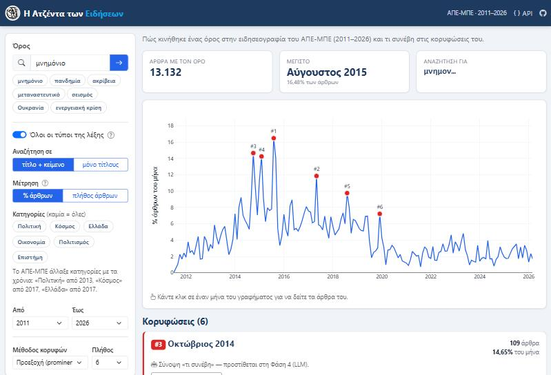
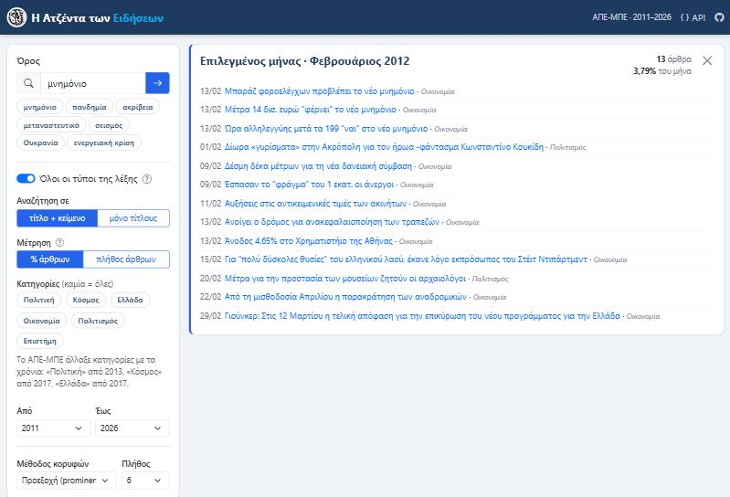
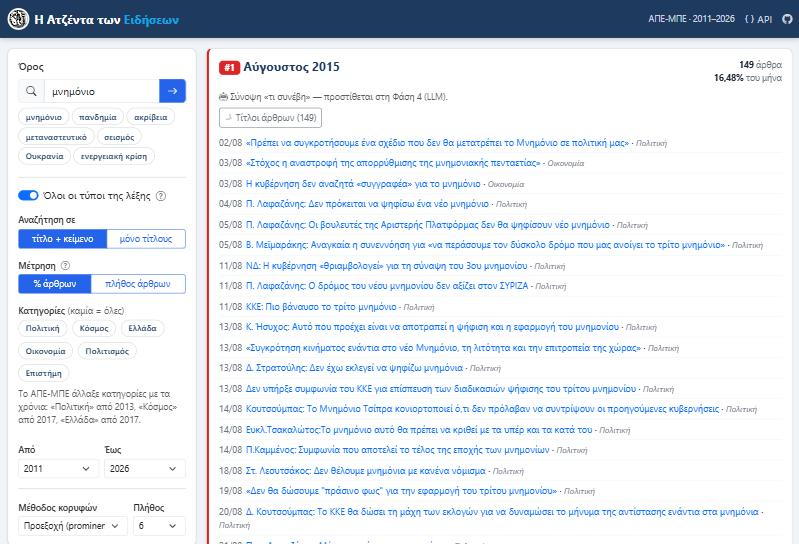
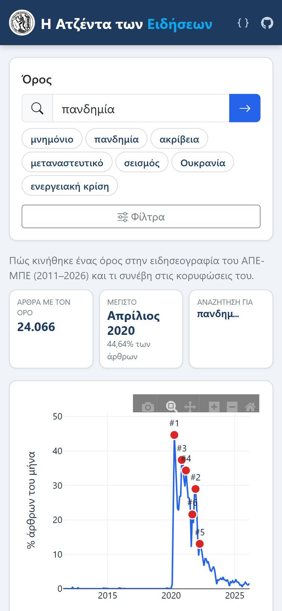

# Οδηγός χρήσης — Η Ατζέντα των Ειδήσεων

Η εφαρμογή δείχνει πώς κινήθηκε ένας όρος (π.χ. «μνημόνιο», «πανδημία», «ακρίβεια») στην ειδησεογραφία του
**ΑΠΕ-ΜΠΕ** από το 2011 έως το 2026, ποιοι μήνες ήταν οι **κορυφώσεις** του και ποια άρθρα γράφτηκαν τότε.

- [Πού θα τη βρείτε](#πού-θα-τη-βρείτε)
- [Είσοδος με κωδικό](#είσοδος-με-κωδικό)
- [Η οθόνη με μια ματιά](#η-οθόνη-με-μια-ματιά)
- [Αναζήτηση](#αναζήτηση)
- [Φίλτρα](#φίλτρα)
- [Το γράφημα](#το-γράφημα)
- [Κορυφώσεις και άρθρα](#κορυφώσεις-και-άρθρα)
- [Σύνοψη «τι συνέβη»](#σύνοψη-τι-συνέβη)
- [Κοινοποίηση αναζήτησης](#κοινοποίηση-αναζήτησης)
- [Σε κινητό](#σε-κινητό)
- [Περιορισμοί που καλό είναι να ξέρετε](#περιορισμοί-που-καλό-είναι-να-ξέρετε)
- [Συχνές ερωτήσεις / προβλήματα](#συχνές-ερωτήσεις--προβλήματα)

---

## Πού θα τη βρείτε

| | Διεύθυνση |
|---|---|
| **Online** (μόλις δημοσιευτεί) | https://asmirniotis98-news-agenda.hf.space |
| **Στον υπολογιστή σας** | διπλό κλικ στο `run.bat` (Windows) ή `python server.py` → http://127.0.0.1:8000 — βλ. [README](README.md) |

Δεν χρειάζεται λογαριασμός ή εγγραφή. Λειτουργεί σε υπολογιστή, tablet και κινητό, σε σύγχρονο browser
(Chrome, Edge, Firefox, Safari).

> Η online έκδοση «κοιμάται» όταν δεν τη χρησιμοποιεί κανείς για αρκετή ώρα. Ο πρώτος επισκέπτης μετά από αυτό
> μπορεί να περιμένει έως περίπου ένα λεπτό μέχρι να ξεκινήσει· μετά λειτουργεί κανονικά.

## Είσοδος με κωδικό

Προς το παρόν η online έκδοση ανοίγει μόνο με **κωδικό πρόσβασης**, που δίνεται μαζί με τον σύνδεσμο. Γράψτε τον στη
σελίδα «Είσοδος» και πατήστε **Είσοδος**· ο browser τον θυμάται για 7 ημέρες. **Έξοδος**: εικονίδιο πάνω δεξιά.

- Ανοίξτε την εφαρμογή **απευθείας** από τη διεύθυνση `…hf.space`. Μέσα από τη σελίδα του Hugging Face η είσοδος μπορεί
  να μη λειτουργεί (ο browser δεν κρατά το cookie σε ενσωματωμένη σελίδα)· η σελίδα εισόδου τότε δείχνει σύνδεσμο.
- Μετά από 10 λάθος προσπάθειες χρειάζεται αναμονή 15 λεπτών.

## Η οθόνη με μια ματιά

1. **Αριστερά** — ο όρος αναζήτησης, έτοιμα παραδείγματα και τα φίλτρα.
2. **Πάνω** — τρεις δείκτες:
   - **Άρθρα με τον όρο**: πόσα άρθρα τον περιέχουν συνολικά (με τα τρέχοντα φίλτρα).
   - **Μέγιστο**: ο μήνας με τη μεγαλύτερη κάλυψη και το ποσοστό των άρθρων εκείνου του μήνα.
   - **Αναζήτηση για**: τι ακριβώς αναζητήθηκε (βλ. [όλοι οι τύποι της λέξης](#όλοι-οι-τύποι-της-λέξης)).
3. **Στη μέση** — το γράφημα ανά μήνα, με τις κορυφώσεις σημειωμένες με κόκκινο (#1, #2, …).
4. **Κάτω** — μία κάρτα για κάθε κορύφωση, με τα άρθρα εκείνου του μήνα.

## Αναζήτηση

Γράψτε μια λέξη ή φράση στο πεδίο **Όρος** και πατήστε **Enter** ή το κουμπί **→**.
Η αναζήτηση γίνεται και αυτόματα λίγο αφού σταματήσετε να πληκτρολογείτε (από 3 γράμματα και πάνω).
Μπορείτε επίσης να πατήσετε ένα από τα **παραδείγματα** κάτω από το πεδίο.

- **Κεφαλαία, πεζά και τόνοι δεν έχουν σημασία**: «Πανδημία», «ΠΑΝΔΗΜΙΑ» και «πανδημια» δίνουν το ίδιο αποτέλεσμα.
- **Φράσεις**: «ενεργειακή κρίση» βρίσκει άρθρα όπου οι δύο λέξεις εμφανίζονται **η μία αμέσως μετά την άλλη**, χωρίς άλλη λέξη ανάμεσα
  (σημεία στίξης ανάμεσα επιτρέπονται).
- Η αναζήτηση γίνεται **με βάση τις λέξεις, όχι το νόημα**: «κορονοϊός» δεν βρίσκει άρθρα που γράφουν μόνο «Covid-19».
  Αν ένα θέμα έχει πολλά ονόματα, δοκιμάστε τα ένα-ένα.

### Όλοι οι τύποι της λέξης

Ο διακόπτης **«Όλοι οι τύποι της λέξης»** (ενεργός από προεπιλογή) βρίσκει και τους άλλους τύπους της λέξης:
«μνημόνιο» βρίσκει και «μνημονίου», «μνημόνια», «μνημονίων». Στον δείκτη **Αναζήτηση για** φαίνεται το κοινό
θέμα που αναζητήθηκε, π.χ. `μνημον…` — οι τρεις τελείες στο τέλος σημαίνουν «με οποιαδήποτε κατάληξη».

- Απενεργοποιήστε τον για να βρείτε **μόνο την ακριβή λέξη** (π.χ. μόνο «μνημόνιο», όχι «μνημόνια»).
- Λέξεις **έως 4 γράμματα** (π.χ. «ΕΚΤ», «ΗΠΑ») αναζητούνται πάντα ακριβώς — αλλιώς το «ΕΚΤ» θα έβρισκε και το «εκτός».

## Φίλτρα

| Φίλτρο | Τι κάνει |
|---|---|
| **Αναζήτηση σε** | *τίτλο + κείμενο* (προεπιλογή, πληρέστερο) ή *μόνο τίτλους* (μόνο άρθρα όπου ο όρος είναι στον τίτλο — λιγότερα αλλά πιο στοχευμένα). |
| **Μέτρηση** | *% άρθρων* (προεπιλογή): τι ποσοστό των άρθρων του μήνα αναφέρει τον όρο. *πλήθος άρθρων*: πόσα άρθρα. |
| **Κατηγορίες** | Πολιτική, Κόσμος, Ελλάδα, Οικονομία, Πολιτισμός, Επιστήμη. Μπορείτε να επιλέξετε περισσότερες από μία· καμία επιλογή = όλες. |
| **Από / Έως** | Το διάστημα ετών του γραφήματος. Οι κορυφώσεις υπολογίζονται μέσα σε αυτό το διάστημα. |
| **Μέθοδος κορυφών** | Πώς επιλέγονται οι κορυφώσεις — βλ. [παρακάτω](#κορυφώσεις-και-άρθρα). |
| **Πλήθος** | Πόσες κορυφώσεις θα εμφανιστούν (1–10). |

**Γιατί ποσοστό και όχι πλήθος;** Το ΑΠΕ-ΜΠΕ δημοσίευε περίπου 300 άρθρα τον μήνα το 2011–2013 και περίπου 3.000 μετά
το 2018. Με το απλό πλήθος, κάθε όρος θα έμοιαζε να «ανεβαίνει» απλώς επειδή γράφονταν περισσότερες ειδήσεις.
Το ποσοστό δείχνει πόσο σημαντικό ήταν το θέμα **σε σχέση με όλη την ειδησεογραφία του μήνα**.

> **Προσοχή στις κατηγορίες:** το ΑΠΕ-ΜΠΕ άλλαξε τις κατηγορίες του με τα χρόνια. Οι κατηγορίες «Ελλάδα» και «Κόσμος»
> υπάρχουν μόνο από το 2017 και η «Πολιτική» από τα τέλη του 2013. Αν τις επιλέξετε, τα προηγούμενα χρόνια θα είναι
> κενά — όχι επειδή δεν γράφτηκε τίποτα, αλλά επειδή τότε τα άρθρα ανήκαν σε άλλη κατηγορία.
> Η εφαρμογή το υπενθυμίζει κάτω από τις κατηγορίες.

## Το γράφημα

- **Περάστε το ποντίκι** πάνω από έναν μήνα για να δείτε πόσα άρθρα αναφέρουν τον όρο, από πόσα συνολικά, και το ποσοστό.
- Οι **κόκκινες τελείες** είναι οι κορυφώσεις· ο αριθμός (#1, #2, …) δείχνει τη σειρά σημαντικότητας (#1 = η ισχυρότερη).
- **Κάντε κλικ σε μια κορύφωση** → η σελίδα πηγαίνει στην κάρτα της και ανοίγει τα άρθρα της.
- **Κάντε κλικ σε οποιονδήποτε άλλον μήνα** → εμφανίζεται πάνω από τις κορυφώσεις μια κάρτα «Επιλεγμένος μήνας»
  με τα άρθρα εκείνου του μήνα (κλείνει με το ×).
- Η μπάρα εργαλείων πάνω δεξιά στο γράφημα (εμφανίζεται με το ποντίκι) επιτρέπει **μεγέθυνση** σε ένα διάστημα,
  **μετακίνηση**, **επαναφορά** (εικονίδιο σπιτιού) και **αποθήκευση ως εικόνα** (εικονίδιο κάμερας).

## Κορυφώσεις και άρθρα

Κάθε κορύφωση έχει μια κάρτα με:
- τη **θέση** της (#1 = η ισχυρότερη) και τον **μήνα**,
- πόσα **άρθρα** του μήνα αναφέρουν τον όρο και τι **ποσοστό** του μήνα είναι αυτά,
- το κουμπί **Τίτλοι άρθρων** — ανοίγει τη λίστα. Πρώτα εμφανίζονται τα άρθρα που έχουν τον όρο **στον τίτλο τους**,
  μετά τα υπόλοιπα, με χρονολογική σειρά. Εμφανίζονται 30 κάθε φορά· το **Περισσότερα** φέρνει τα επόμενα.
  Κάθε τίτλος ανοίγει το πλήρες άρθρο στο **amna.gr** σε νέα καρτέλα.
- **Τι συνέβη** — σύντομη αυτόματη σύνοψη του μήνα (βλ. [παρακάτω](#σύνοψη-τι-συνέβη)).

Οι κάρτες εμφανίζονται με **χρονολογική σειρά**.

### Μέθοδος κορυφών

| Μέθοδος | Τι βρίσκει | Πότε να τη χρησιμοποιήσετε |
|---|---|---|
| **Προεξοχή (prominence)** — προεπιλογή | Τους μήνες που **ξεχωρίζουν περισσότερο** από τους γύρω τους. | Για το ερώτημα «πότε μιλούσαν περισσότερο για αυτό;» |
| **Απόκλιση από τον μέσο όρο 12 μηνών (z-score)** | Τους μήνες με **απότομη άνοδο** σε σχέση με τον προηγούμενο χρόνο. | Για το ερώτημα «πότε **ξεκίνησε** να συζητιέται;» — π.χ. για την πανδημία βρίσκει τον Μάρτιο 2020. |

Και οι δύο μέθοδοι αγνοούν πολύ μικρές διακυμάνσεις (λιγότερα από 5 άρθρα, ή πολύ χαμηλά σε σχέση με το μέγιστο του όρου)
και κρατούν τουλάχιστον 3 μήνες απόσταση ανάμεσα σε δύο κορυφώσεις.

## Σύνοψη «τι συνέβη»

Οι συνόψεις είναι **κλειστές από προεπιλογή**. Ανοίξτε τις με τον διακόπτη **Αυτόματες συνόψεις (LLM)** στην αριστερή
στήλη (σε κινητό: κάτω από τα παραδείγματα). Κάθε φορά που τον ανοίγετε εμφανίζεται ένα παράθυρο με το κουτί
**«Δεν είμαι ρομπότ»** — τικάρετε το κουτί, πατάτε **Ενεργοποίηση** και οι συνόψεις ανοίγουν για έως 2 ώρες. Αν κλείσετε
το παράθυρο χωρίς επιβεβαίωση, ο διακόπτης γυρίζει πίσω. Το κλείσιμο του διακόπτη σταματά αμέσως τις συνόψεις.

Με τον διακόπτη ανοιχτό, σε κάθε κάρτα κορύφωσης εμφανίζεται το πλαίσιο **Τι συνέβη**: έως 4 σύντομες προτάσεις για τα
κύρια γεγονότα του μήνα σε σχέση με τον όρο. Στην κάρτα «Επιλεγμένος μήνας» η σύνοψη δημιουργείται με το κουμπί
**Σύνοψη «τι συνέβη»**.

- Γράφεται **αυτόματα από γλωσσικό μοντέλο (LLM)**, με οδηγία να χρησιμοποιήσει **μόνο τους τίτλους** των άρθρων του μήνα
  (έως 80, πρώτα όσοι έχουν τον όρο στον τίτλο τους). Κάτω από τη σύνοψη φαίνεται πόσοι τίτλοι χρησιμοποιήθηκαν.
- **Μπορεί να περιέχει ανακρίβειες.** Ελέγξτε την πάντα με τους τίτλους της κάρτας και τα πρωτότυπα άρθρα στο amna.gr.
- Η πρώτη φορά για έναν όρο και μήνα χρειάζεται λίγα δευτερόλεπτα· μετά η σύνοψη αποθηκεύεται και εμφανίζεται αμέσως,
  σε όλους τους επισκέπτες.

### Το δικό σας κλειδί API

Όσες συνόψεις έχουν ήδη δημιουργηθεί εμφανίζονται **χωρίς κλειδί**. Για **νέες** συνόψεις χρειάζεται το δικό σας κλειδί
API. Μετά το κουτί «Δεν είμαι ρομπότ» εμφανίζεται παράθυρο σε τρία βήματα (ή αργότερα από τον σύνδεσμο **Προσθήκη
κλειδιού** κάτω από τον διακόπτη):

1. **Πάροχος:** **Claude** (Anthropic) ή **ChatGPT** (OpenAI).
2. **Μοντέλο για την ανάλυση**, με το εκτιμώμενο κόστος ανά σύνοψη:

   | Πάροχος | Μοντέλο | Περίπου ανά σύνοψη |
   |---|---|---|
   | Claude | Haiku 5.5 (προεπιλογή) · Sonnet 5.5 · Opus 5.5 | $0,001 · $0,016 · $0,03 |
   | ChatGPT | GPT-5.4 nano (προεπιλογή) · GPT-5.4 mini | $0,002 · $0,006 |

3. **Κλειδί API**, από το [Anthropic Console](https://console.anthropic.com/settings/keys) (ξεκινά με `sk-ant-`) ή το
   [OpenAI Platform](https://platform.openai.com/api-keys) (ξεκινά με `sk-proj-` ή `sk-`). Αν επικολλήσετε κλειδί του άλλου
   παρόχου, η επιλογή παρόχου αλλάζει αυτόματα.

Το κόστος χρεώνεται στον δικό σας λογαριασμό. Οι συνόψεις που δημιουργείτε εμφανίζονται μετά και σε άλλους επισκέπτες
(χωρίς κόστος για αυτούς), με το όνομα του μοντέλου που τις έγραψε.

Τι γίνεται με το κλειδί σας:
- **Δεν αποθηκεύεται πουθενά** (αρχείο, βάση, logs, cookies). Κρατιέται μόνο στη μνήμη του server και στέλνεται μόνο στον
  πάροχο που διαλέξατε, μέσω HTTPS. Η σελίδα δεν το εμφανίζει ποτέ ξανά.
- Ισχύει **30 λεπτά**. Πέντε λεπτά πριν τη λήξη εμφανίζεται μήνυμα με κουμπί **Ανανέωση** για άλλα 30 λεπτά· αλλιώς το
  κλειδί σβήνεται και, για νέες συνόψεις, το επικολλάτε ξανά.
- Λειτουργεί **μόνο από τη σύνδεση (IP) όπου το επικολλήσατε**. Αν αλλάξει (π.χ. από Wi-Fi σε δίκτυο κινητού), σβήνεται
  αμέσως και σας ζητείται ξανά.
- Σβήνεται αμέσως με **Διαγραφή κλειδιού**, με το κλείσιμο του διακόπτη ή με επανεκκίνηση της υπηρεσίας.
- Έως 50 νέες συνόψεις ανά κλειδί, ώστε ένα λάθος να μη σας χρεώσει πολύ.
- Οι νέες συνόψεις που πληρώνετε αποθηκεύονται και εμφανίζονται και σε άλλους επισκέπτες.
- Συμβουλή: φτιάξτε **ξεχωριστό κλειδί** με όριο χρέωσης για αυτή τη χρήση και ανακαλέστε το όταν τελειώσετε.

## Κοινοποίηση αναζήτησης

Η διεύθυνση στον browser αλλάζει με κάθε αναζήτηση και περιέχει τον όρο και τα φίλτρα, π.χ.
`…/?q=σεισμός&cat=Ελλάδα`. **Αντιγράψτε τη διεύθυνση** και στείλτε τη — όποιος την ανοίξει θα δει ακριβώς την ίδια
αναζήτηση.

## Σε κινητό

Σε μικρές οθόνες τα φίλτρα κρύβονται πίσω από το κουμπί **Φίλτρα**, ώστε το γράφημα να φαίνεται αμέσως.
Πατήστε το για να τα ανοίξετε ή να τα κλείσετε. Στο γράφημα, ένα άγγιγμα σε μήνα λειτουργεί όπως το κλικ.

## Περιορισμοί που καλό είναι να ξέρετε

- **Περίοδος**: τα δεδομένα καλύπτουν 29/06/2011 – 30/03/2026 (341.613 άρθρα). Νεότερα άρθρα δεν περιλαμβάνονται.
- **Λιγότερα άρθρα τα πρώτα χρόνια**: το 2011–2013 υπάρχουν ~10 φορές λιγότερα άρθρα ανά μήνα απ' ό,τι μετά το 2018,
  οπότε τα ποσοστά εκείνων των ετών «πηδούν» πιο εύκολα.
- **Κατηγορίες**: «Ελλάδα» και «Κόσμος» μόνο από το 2017 (βλ. [Φίλτρα](#φίλτρα)).
- **Λέξεις, όχι νόημα**: συνώνυμα και διαφορετικές ονομασίες πρέπει να αναζητηθούν χωριστά. Πολύ γενικές λέξεις
  (π.χ. «κρίση») εμφανίζονται σε πολλά άσχετα θέματα.
- **Ταχύτητα**: οι περισσότερες αναζητήσεις είναι σχεδόν στιγμιαίες. Όροι με **ψηφία ή σύμβολα** (π.χ. «Covid-19»)
  και φράσεις **3 ή περισσότερων λέξεων** χρειάζονται 1–2 δευτερόλεπτα.
- **Πρώτη επίσκεψη**: η online έκδοση μπορεί να χρειαστεί έως περίπου ένα λεπτό αν «κοιμόταν».
- **Συνόψεις**: βασίζονται μόνο στους τίτλους, όχι στα πλήρη κείμενα· είναι αυτόματες και μπορεί να έχουν λάθη.

## Συχνές ερωτήσεις / προβλήματα

**«Δεν βρέθηκαν άρθρα»** — Ελέγξτε την ορθογραφία, ενεργοποιήστε το «Όλοι οι τύποι της λέξης», επιλέξτε «τίτλο + κείμενο»
και αφαιρέστε φίλτρα κατηγορίας/ετών.

**«Δεν εντοπίστηκαν σαφείς κορυφές»** — Ο όρος εμφανίζεται ομοιόμορφα χωρίς ξεχωριστές εξάρσεις. Δοκιμάστε την άλλη
μέθοδο ή ευρύτερο διάστημα ετών.

**«Πάρα πολλά αιτήματα. Δοκιμάστε ξανά σε λίγο.»** — Για την προστασία της υπηρεσίας κάθε επισκέπτης μπορεί να κάνει
έως 60 αναζητήσεις το λεπτό. Περιμένετε λίγα δευτερόλεπτα.

**«Για νέα σύνοψη χρειάζεται το δικό σας κλειδί»** — Δεν υπάρχει ακόμη σύνοψη για αυτόν τον όρο και μήνα. Πατήστε
**Προσθήκη κλειδιού** (βλ. [Το δικό σας κλειδί API](#το-δικό-σας-κλειδί-api)).

**«Το κλειδί δεν έγινε δεκτό»** — Ελέγξτε ότι αντιγράψατε ολόκληρο το κλειδί, ότι διαλέξατε τον σωστό πάροχο (`sk-ant-` =
Claude, `sk-proj-`/`sk-` = ChatGPT), ότι δεν έχει ανακληθεί και ότι ο λογαριασμός σας έχει υπόλοιπο.

**«Το κλειδί δεν έχει πρόσβαση στο μοντέλο …»** — Ο λογαριασμός σας δεν επιτρέπει αυτό το μοντέλο· διαλέξτε άλλο από
τη λίστα.

**Τα πρώτα χρόνια είναι κενά** — Μάλλον έχετε επιλέξει την κατηγορία «Ελλάδα» ή «Κόσμος», που υπάρχουν μόνο από το 2017.

**Η σελίδα δεν φορτώνει online** — Αν η εφαρμογή «κοιμόταν», περιμένετε έως ένα λεπτό και ανανεώστε τη σελίδα.

**Θέλω τα δεδομένα για δική μου ανάλυση** — Τα στοιχεία του γραφήματος και των άρθρων διατίθενται και ως JSON μέσω του
API· η τεκμηρίωσή του είναι στο **API** (πάνω δεξιά) ή στη διεύθυνση `/docs`.

---

**Δεδομένα**: [glossAPI/amna-press](https://huggingface.co/datasets/glossAPI/amna-press) — ειδησεογραφία του ΑΠΕ-ΜΠΕ,
άδεια [CC BY-NC-ND 4.0](https://creativecommons.org/licenses/by-nc-nd/4.0/). Τα πλήρη άρθρα ανήκουν στο ΑΠΕ-ΜΠΕ και
διαβάζονται στο amna.gr· η εφαρμογή εμφανίζει μόνο τίτλους, συνδέσμους και στατιστικά.
